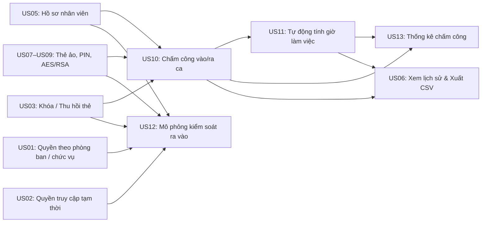

# Kế hoạch triển khai chi tiết — `US10` đến `US13`

**Phạm vi phụ trách:** Nghiệp vụ chấm công (`US10`), tính thời gian làm việc (`US11`), thống kê dữ liệu chấm công (`US13`) và mô phỏng kiểm soát ra vào khu vực (`US12`).
**Tổng khối lượng:** `4 User Story` · `16 SP` (`Tuần 1: 5 SP` · `Tuần 2: 11 SP`).

---

## 1. Tổng quan mục tiêu & Phạm vi (`US10`–`US13`)

### Bảng tổng hợp User Story phụ trách

| ID | User Story | Sprint / Giai đoạn | SP | Tiêu chí nghiệm thu (theo file phân công) |
|---|---|---|---:|---|
| `US10` | Chấm công vào ca, ra ca | Tuần 1 (Sprint 1) | 5 | Ghi check-in/check-out hợp lệ và lưu thời điểm vào hệ thống |
| `US11` | Tự động tính thời gian làm việc | Tuần 2 (Sprint 2A) | 3 | Tính số giờ từ cặp vào-ra và xử lý ca thiếu dữ liệu |
| `US13` | Thống kê dữ liệu chấm công | Tuần 2 (Sprint 2A) | 3 | Tổng hợp số lần chấm công, ngày công/giờ làm theo nhân viên, khoảng ngày |
| `US12` | Mô phỏng kiểm soát ra vào khu vực | Tuần 2 (Sprint 2B) | 5 | Nhập/chọn thẻ ảo, khu vực, thời điểm; trả kết quả cho phép/từ chối theo quyền và trạng thái thẻ |
| **Tổng** | **4 User Story** | **2 Sprint (14 ngày)** | **16** | **Hoàn thiện đầu-cuối (model, nghiệp vụ, UI, test, nội dung báo cáo kỹ thuật)** |

### Ranh giới hệ thống & Nguyên tắc kiến trúc (theo `AGENTS.md` và phạm vi mô phỏng)
- **Phạm vi mô phỏng trên máy tính:** Sử dụng thẻ ảo chạy trên PC; không dùng thẻ vật lý/NFC hay đầu đọc phần cứng; cơ chế AES/RSA chỉ phục vụ mô phỏng và không khẳng định mức bảo mật phần cứng.
- **Phân tách trách nhiệm Thẻ (`EmployeeCardApplet.java`) vs Host App:**
  - **Phía thẻ (Java Card Applet):** Chỉ giữ lưu trữ kích thước cố định, kiểm tra trạng thái thẻ/phiên PIN, xử lý APDU và đưa ra quyết định cấp thẻ gọn nhẹ; **không cấp phát đối tượng động (`new`) trong `process()`**.
  - **Phía ứng dụng Host:** Lưu trữ bền vững toàn bộ lịch sử chấm công, ghép cặp ca làm việc & tính giờ (`US11`), giao diện/nhật ký mô phỏng kiểm soát ra vào (`US12`), thống kê tổng hợp (`US13`) và cung cấp nguồn dữ liệu chuẩn cho chức năng xem/xuất CSV (`US06`).
- **Quyền sở hữu đầu-cuối:** Tự thiết kế mô hình dữ liệu, xử lý nghiệp vụ, giao diện sử dụng, kịch bản kiểm thử đơn vị/tích hợp và phần mô tả kỹ thuật cho `US10`–`US13`.

---

## 2. Kiến trúc tích hợp & Chiến lược phát triển độc lập (Contract-First)

### Sơ đồ phụ thuộc giữa các module

### Chiến lược Contract-First (không bị nghẽn bởi tiến độ module khác)
Để có thể code, chạy UI và viết unit test cho `US10`–`US13` ngay từ Ngày 2 mà không phải chờ `US01`–`US09` hoàn tất, toàn bộ phụ thuộc ngoài sẽ đi qua 4 interface tách biệt:

1. **`EmployeeProvider`** *(tương ứng `US05`)*:
   - `findById(employeeId)`, `findAll()`, `exists(employeeId)` → trả về `Employee`.
2. **`VirtualCardProvider`** *(tương ứng `US07`–`US09` & `US03`)*:
   - `findByCardId(cardId)`, `findByEmployeeId(employeeId)`, `isPinVerified(cardId)`, `verifySimulatedSignature(cardId, payload)`.
3. **`AccessPolicyProvider`** *(tương ứng `US01` & `US02`)*:
   - `findAreaById(areaId)`, `findPermanentRules(areaId)`, `findTemporaryGrants(employeeId, areaId)`.
4. **`CardGateway`** *(cầu nối phía thẻ)*:
   - Chuẩn hóa lệnh giao tiếp xuống thẻ (`recordAttendancePunch`, `getLastAttendance`, `checkAreaAccessOnCard`), hỗ trợ 2 implementation hoán đổi được:
     - `VirtualStoreCardGateway`: đọc/ghi trực tiếp kho thẻ ảo trên PC (phát triển nhanh & test độc lập).
     - `ApduSimulatorCardGateway`: gửi/nhận APDU tới `EmployeeCardApplet` trên bộ mô phỏng Java Card (kiểm thử tích hợp).

Trong giai đoạn phát triển độc lập, cung cấp bộ **Mock/Seed Fixtures** cố định (nhân viên mẫu thuộc các phòng ban/chức vụ khác nhau, thẻ ở các trạng thái `ACTIVE`/`LOCKED`/`REVOKED`, quy tắc quyền cố định và quyền tạm thời còn hạn/hết hạn/chưa tới hạn). Khi tích hợp cuối tuần, chỉ cần thay adapter bằng repository/service thật của nhóm.

---

## 3. Đặc tả mô hình dữ liệu (Ngày 1–2 — Thống nhất cấu trúc chung)

### 3.1. Mô hình đầu vào dùng chung (cần chốt schema với nhóm ở Ngày 1–2)

| Thực thể | Trường dữ liệu | Kiểu & Ràng buộc | Ghi chú tích hợp |
|---|---|---|---|
| `Employee` | `employeeId`, `fullName`, `department`, `position`, `active` | `String` (PK, không rỗng), `String`, `String`, `String`, `boolean` | Đồng bộ từ `US05`; chuẩn hóa viết hoa/slug hoặc mã phòng ban, chức vụ |
| `VirtualCard` | `cardId`, `employeeId`, `status`, `pinVerified`, `cryptoEnabled`, `issuedAt` | `String` (PK), `String` (FK), `CardStatus`: `ACTIVE \| LOCKED \| REVOKED`, `boolean`, `boolean`, `Instant/LocalDateTime` | `status` đồng bộ giữa `US07` và `US03` |
| `Area` | `areaId`, `areaCode`, `areaName`, `securityLevel` | `String` (PK), `byte/int` (`1..255` cho APDU), `String`, `int` | Phục vụ cả `US01`, `US02` và `US12` |
| `AccessRule` | `ruleId`, `areaId`, `department`, `position`, `matchMode`, `enabled` | `String`, `String`, `String` (nullable), `String` (nullable), `DEPARTMENT_OR_POSITION \| DEPARTMENT_AND_POSITION`, `boolean` | **Cần chốt sớm với `US01` quy tắc khớp `OR` hay `AND`** |
| `TemporaryGrant` | `grantId`, `employeeId`, `areaId`, `startTime`, `endTime`, `revoked`, `reason` | `String`, `String`, `String`, `LocalDateTime`, `LocalDateTime`, `boolean`, `String` | Từ `US02`; hiệu lực khi `!revoked && startTime <= attemptTime <= endTime` |

### 3.2. Mô hình sở hữu (`US10`–`US13`)

#### `AttendanceRecord` (`US10`)
| Trường | Kiểu | Bắt buộc | Mô tả |
|---|---|---|---|
| `recordId` | `String` (UUID / `ATT-yyyyMMdd-xxxx`) | Có | Khóa chính bản ghi chấm công |
| `employeeId` | `String` | Có | Mã nhân viên gắn với thẻ tại thời điểm chấm công |
| `cardId` | `String` | Có | Mã thẻ ảo thực hiện chấm công |
| `eventType` | `AttendanceEventType` (`CHECK_IN \| CHECK_OUT`) | Có | Loại sự kiện vào ca hoặc ra ca |
| `timestamp` | `LocalDateTime` | Có | Thời điểm chấm công chuẩn hóa (ISO-8601 khi lưu/trao đổi) |
| `source` | `String` (`HOST_UI \| APDU_SIM`) | Có | Nguồn phát sinh bản ghi |
| `note` | `String` | Không | Ghi chú bổ sung (ví dụ: ghi nhận bất thường theo cấu hình) |

#### `WorkShift` (`US11`)
| Trường | Kiểu | Bắt buộc | Mô tả |
|---|---|---|---|
| `shiftId` | `String` | Có | Mã ca làm việc được tổng hợp từ cặp bản ghi |
| `employeeId` | `String` | Có | Mã nhân viên |
| `workDate` | `LocalDate` | Có | Ngày làm việc (lấy theo ngày của `checkInTime`; nếu thiếu vào thì lấy ngày của `checkOutTime`) |
| `checkInRecordId` | `String` (nullable) | Không | ID bản ghi `CHECK_IN` |
| `checkOutRecordId` | `String` (nullable) | Không | ID bản ghi `CHECK_OUT` |
| `checkInTime` | `LocalDateTime` (nullable) | Không | Thời điểm vào ca |
| `checkOutTime` | `LocalDateTime` (nullable) | Không | Thời điểm ra ca |
| `workedMinutes` | `long` (`>= 0`) | Có | Số phút làm việc tính chính xác theo phút (`0` nếu ca thiếu dữ liệu/lỗi) |
| `workedHours` | `double` / `BigDecimal` | Có | Làm tròn 2 chữ số thập phân từ `workedMinutes / 60.0` |
| `status` | `ShiftStatus` | Có | `COMPLETE \| MISSING_CHECK_OUT \| MISSING_CHECK_IN \| INVALID_ORDER` |

#### `AccessAttemptLog` (`US12`)
| Trường | Kiểu | Bắt buộc | Mô tả |
|---|---|---|---|
| `logId` | `String` | Có | Mã bản ghi mô phỏng ra vào |
| `cardId` | `String` | Có | Mã thẻ được nhập/chọn |
| `employeeId` | `String` (nullable) | Không | Mã nhân viên (null nếu thẻ không tồn tại) |
| `areaId` | `String` | Có | Khu vực kiểm tra |
| `attemptTime` | `LocalDateTime` | Có | Thời điểm giả lập kiểm tra ra vào |
| `decision` | `AccessDecision` (`ALLOW \| DENY`) | Có | Kết quả cuối cùng |
| `reasonCode` | `AccessReasonCode` | Có | Mã lý do chi tiết (xem mục 5.4) |
| `reasonDetail` | `String` | Có | Thông điệp tiếng Việt hiển thị trên UI |
| `matchedRuleId` | `String` (nullable) | Không | ID của `AccessRule` hoặc `TemporaryGrant` khớp (nếu có) |

#### `AttendanceStatistics` (`US13`)
| Trường | Kiểu | Mô tả |
|---|---|---|
| `employeeId` | `String` | Mã nhân viên |
| `fullName` | `String` | Họ tên nhân viên |
| `department` | `String` | Phòng ban |
| `fromDate` | `LocalDate` | Ngày bắt đầu khoảng thống kê (bao gồm) |
| `toDate` | `LocalDate` | Ngày kết thúc khoảng thống kê (bao gồm) |
| `totalPunches` | `int` | Tổng số lượt chấm công (`checkInCount + checkOutCount`) |
| `checkInCount` | `int` | Số lần `CHECK_IN` trong khoảng ngày |
| `checkOutCount` | `int` | Số lần `CHECK_OUT` trong khoảng ngày |
| `completedShifts` | `int` | Số ca có trạng thái `COMPLETE` |
| `incompleteShifts` | `int` | Số ca thiếu dữ liệu (`MISSING_CHECK_OUT`, `MISSING_CHECK_IN`, `INVALID_ORDER`) |
| `workDays` | `int` | Số ngày công hợp lệ (số ngày dương lịch duy nhất có ít nhất 1 ca `COMPLETE`) |
| `totalHours` | `double` / `BigDecimal` | Tổng số giờ làm việc (tổng `workedMinutes / 60.0`, làm tròn 2 chữ số) |
| `averageHoursPerWorkDay` | `double` / `BigDecimal` | Trung bình giờ/ngày công (`totalHours / workDays`, `0.00` nếu `workDays == 0`) |

---

## 4. Đặc tả giao thức APDU đề xuất cho `EmployeeCardApplet` (đồng bộ `AGENTS.md`)

> Phải phối hợp rà soát bảng mã `INS` với thành viên phụ trách `US07`–`US09` và `US01`–`US03` trong Ngày 1–2 để bảo đảm không trùng lệnh trong `CLA = 0x80`.

### Bảng lệnh APDU đề xuất (phần chấm công & kiểm tra ra vào)

| Lệnh | `CLA` | `INS` | `P1` | `P2` | `Lc` & Payload vào | Dữ liệu trả về (`Le`) | Hành vi phía thẻ |
|---|---:|---:|---:|---:|---|---|---|
| `INS_ATTENDANCE_PUNCH` | `0x80` | `0x40` | `0x01` (CHECK_IN) `0x02` (CHECK_OUT) | `0x00` | `5 bytes`: `[epochSec (4B big-endian), terminalAreaId (1B)]` | `2 bytes`: `[punchCounter (1B), currentShiftState (1B)]` | Kiểm tra thẻ `ACTIVE` & phiên PIN đã xác thực; ghi vào circular buffer kích thước cố định trên thẻ |
| `INS_GET_LAST_ATTENDANCE` | `0x80` | `0x42` | `0x00` | `0x00` | Không có (`Lc = 0`) | `7 bytes`: `[lastEventType (1B), lastEpochSec (4B), lastAreaId (1B), currentShiftState (1B)]` | Đọc bản ghi gần nhất và trạng thái ca hiện tại từ bộ nhớ tĩnh |
| `INS_CHECK_AREA_ACCESS` | `0x80` | `0x50` | `areaId (0x01..0xFF)` | `0x00` | `4 bytes`: `[attemptEpochSec (4B big-endian)]` | `2 bytes`: `[decision (1B: 0x01=ALLOW, 0x00=DENY), reasonCode (1B)]` | Kiểm tra trạng thái thẻ (`ACTIVE` vs `LOCKED`/`REVOKED`), phiên PIN và quyền trên thẻ |

### Mã trạng thái chuẩn (Status Words)

| SW | Hằng số Java Card | Ý nghĩa |
|---|---|---|
| `0x9000` | `ISO7816.SW_NO_ERROR` | Thực thi thành công |
| `0x6982` | `ISO7816.SW_SECURITY_STATUS_NOT_SATISFIED` | Chưa xác thực mã PIN hoặc chưa qua bước xác thực mật mã |
| `0x6983` | `SW_CARD_LOCKED_OR_REVOKED` *(custom)* / `0x6983` | Thẻ đang bị khóa hoặc đã thu hồi, không cho phép sử dụng |
| `0x6985` | `ISO7816.SW_CONDITIONS_NOT_SATISFIED` | Trạng thái ca/điều kiện nghiệp vụ không hợp lệ |
| `0x6A80` | `ISO7816.SW_WRONG_DATA` | Payload thời gian/khu vực sai định dạng |
| `0x6A86` | `ISO7816.SW_INCORRECT_P1P2` | Tham số `P1`/`P2` không hợp lệ (`eventType` hoặc `areaId` sai) |
| `0x6700` | `ISO7816.SW_WRONG_LENGTH` | Độ dài dữ liệu `Lc` không khớp đặc tả |

### Ràng buộc cài đặt trên Java Card
- Cấp phát trước toàn bộ mảng trạng thái và bộ đệm vòng (ví dụ circular buffer `MAX_ATTENDANCE_ENTRIES = 16`, mỗi phần tử `6 bytes`) trong constructor của `EmployeeCardApplet`.
- Dùng `JCSystem.beginTransaction()` / `commitTransaction()` khi cập nhật bản ghi chấm công gần nhất và con trỏ bộ đệm vòng.
- Không khởi tạo đối tượng mới, không nối chuỗi, không dùng cấu trúc động bên trong `process(APDU apdu)`.
- Sau mỗi thay đổi applet, build lại CAP bằng Eclipse (**Project > Clean > Build Project**) hoặc `javac` + converter theo `configurations/EmployeeSmartCard.conf` và test đầy đủ status words trên simulator.

---

## 5. Kế hoạch thiết kế & triển khai chi tiết từng User Story

### 5.1. `US10` — Chấm công vào ca, ra ca (Tuần 1 · 5 SP)

- **Mục tiêu:** Ghi nhận sự kiện `CHECK_IN` / `CHECK_OUT` hợp lệ, gắn đúng nhân viên/thẻ ảo, lưu thời điểm vào hệ thống và phản hồi tức thì trên giao diện.
- **Luồng xử lý đầu-cuối:**
  1. Người dùng chọn hoặc nhập `cardId`, chọn thao tác `Vào ca (CHECK_IN)` hoặc `Ra ca (CHECK_OUT)` và thời điểm (mặc định thời gian hệ thống, có tùy chọn chọn giờ khi chạy kịch bản test).
  2. `AttendanceService.punch(cardId, eventType, timestamp)`:
     - Kiểm tra thẻ tồn tại (`VirtualCardProvider`).
     - Kiểm tra trạng thái thẻ phải là `ACTIVE` (từ chối nếu `LOCKED` hoặc `REVOKED`).
     - Kiểm tra trạng thái xác thực PIN/mật mã nếu chế độ bảo mật đang bật (`pinVerified` / chữ ký mô phỏng).
     - Kiểm tra nhân viên gắn thẻ còn tồn tại và đang làm việc (`EmployeeProvider`).
     - Kiểm tra chống bấm đúp (debounce, ví dụ `< 60 giây` cùng loại sự kiện cho cùng một thẻ).
     - Kiểm tra trạng thái ca hiện tại:
       - Nếu đã có `CHECK_IN` chưa đóng trong ngày: từ chối `CHECK_IN` lặp lại (hoặc chỉ cho phép nếu sang ngày làm việc mới để vẫn tạo được dữ liệu test `MISSING_CHECK_OUT` cho `US11`).
       - Nếu chưa có `CHECK_IN` mở: cấu hình mặc định từ chối `CHECK_OUT` trực tiếp với thông báo rõ ràng; đồng thời hỗ trợ cờ chế độ nhập dữ liệu thiếu (`allowOrphanRecordForTesting` hoặc bản ghi giả lập) để kiểm thử đầy đủ các nhánh xử lý ca thiếu dữ liệu ở `US11`.
  3. Gửi lệnh xuống `CardGateway.recordAttendancePunch(...)` và lưu `AttendanceRecord` vào `AttendanceRepository`.
  4. Cập nhật bảng lịch sử chấm công gần nhất trên UI.
- **Tổ chức module đề xuất:**
  - `model`: `AttendanceRecord`, `AttendanceEventType`
  - `repository`: `AttendanceRepository` (interface + bản lưu file JSON/CSV/SQLite cục bộ hoặc bộ nhớ kèm persistence)
  - `service`: `AttendanceService`
  - `ui`: Màn hình/Panel **Chấm công** (chọn thẻ, nút Check-in / Check-out, thẻ trạng thái kết quả, bảng lịch sử trong ngày)
- **Checklist hoàn thành Sprint 1 (Ngày 7):**
  - [ ] Tạo & lưu được bản ghi `CHECK_IN`, `CHECK_OUT` kèm timestamp chính xác.
  - [ ] Từ chối thẻ không tồn tại, thẻ `LOCKED`/`REVOKED`, bấm đúp liên tiếp.
  - [ ] Demo được luồng chấm công bằng bộ dữ liệu mẫu vào cuối Tuần 1.

### 5.2. `US11` — Tự động tính thời gian làm việc (Tuần 2 · Sprint 2A · 3 SP)

- **Mục tiêu:** Tự động ghép các bản ghi `CHECK_IN` và `CHECK_OUT` theo trình tự thời gian để tạo `WorkShift`, tính chính xác số giờ làm việc và phân loại rõ các ca thiếu dữ liệu.
- **Thuật toán ghép cặp ca (`ShiftPairingService`):**
  1. Lấy toàn bộ `AttendanceRecord` của từng `employeeId` trong khoảng truy vấn, sắp xếp tăng dần theo `timestamp` (sau đó theo `recordId`).
  2. Duyệt tuần tự với biến giữ `openCheckIn`:
     - Gặp `CHECK_IN`:
       - Nếu `openCheckIn == null`: gán `openCheckIn = record`.
       - Nếu `openCheckIn != null` (gặp 2 `CHECK_IN` liên tiếp): chốt `openCheckIn` cũ thành ca `MISSING_CHECK_OUT` (`workedMinutes = 0`, `workDate = openCheckIn.date`), rồi mở `openCheckIn = record` mới.
     - Gặp `CHECK_OUT`:
       - Nếu `openCheckIn == null`: tạo ngay ca `MISSING_CHECK_IN` (`workedMinutes = 0`, `workDate = record.date`).
       - Nếu `openCheckIn != null`:
         - Nếu `record.timestamp <= openCheckIn.timestamp`: đánh dấu `INVALID_ORDER` (`workedMinutes = 0`).
         - Tính `minutes = ChronoUnit.MINUTES.between(openCheckIn.timestamp, record.timestamp)`.
         - Kiểm tra ngưỡng hợp lệ cho ca qua đêm (ví dụ `minutes <= 24 * 60`): nếu vượt ngưỡng tối đa (ví dụ quên check-out nhiều ngày trước rồi mới check-out hôm sau), tách `openCheckIn` thành `MISSING_CHECK_OUT` và `record` thành `MISSING_CHECK_IN` thay vì cộng dồn sai hàng chục giờ; ngược lại tạo ca `COMPLETE` với `workedMinutes = minutes` và `workedHours = round2(minutes / 60.0)`.
         - Đặt lại `openCheckIn = null`.
  3. Sau khi kết thúc vòng lặp, nếu `openCheckIn != null`: đóng thành `MISSING_CHECK_OUT` (`workedMinutes = 0`).
- **Hiển thị & Tái sử dụng:**
  - Hiển thị bảng danh sách `WorkShift` kèm badge trạng thái (`Đủ ca`, `Thiếu giờ ra`, `Thiếu giờ vào`, `Sai thứ tự`) và tổng giờ làm việc.
  - Cung cấp phương thức công khai `calculateShifts(employeeId, fromDate, toDate)` để `US13` (thống kê) và `US06` (lịch sử & xuất CSV) gọi dùng chung, bảo đảm số giờ hiển thị ở mọi màn hình hoàn toàn khớp nhau.

### 5.3. `US13` — Thống kê dữ liệu chấm công (Tuần 2 · Sprint 2A · 3 SP)

- **Mục tiêu:** Tổng hợp số lần chấm công, ngày công và giờ làm việc theo từng nhân viên (hoặc toàn bộ/theo phòng ban) trong khoảng ngày tùy chọn.
- **Đầu vào & Validate bộ lọc:**
  - Chọn khoảng ngày `[fromDate, toDate]` (bắt buộc `fromDate <= toDate`; nếu ngược, báo lỗi validate rõ ràng).
  - Tùy chọn lọc theo `employeeId` cụ thể hoặc `Tất cả nhân viên` / `Phòng ban`.
- **Công thức tổng hợp (`AttendanceStatisticsService`):**
  - Lọc `AttendanceRecord` có `timestamp.toLocalDate()` thuộc `[fromDate, toDate]`:
    - `checkInCount` = số bản ghi `CHECK_IN`
    - `checkOutCount` = số bản ghi `CHECK_OUT`
    - `totalPunches` = `checkInCount + checkOutCount`
  - Gọi `ShiftPairingService.calculateShifts(...)` cho tập nhân viên đang lọc:
    - Lấy các ca có `workDate` thuộc `[fromDate, toDate]`:
    - `completedShifts` = số ca `COMPLETE`
    - `incompleteShifts` = số ca có trạng thái khác `COMPLETE`
    - `workDays` = số ngày dương lịch duy nhất (`Set<LocalDate>`) có ít nhất 1 ca `COMPLETE` *(ghi chú thêm nếu cần quy đổi ngày công chuẩn 8 giờ ở phần hiển thị phụ)*
    - `totalMinutes` = tổng `workedMinutes` của các ca `COMPLETE`
    - `totalHours` = `round2(totalMinutes / 60.0)`
    - `averageHoursPerWorkDay` = `workDays > 0 ? round2(totalHours / workDays) : 0.00`
- **Giao diện hiển thị (`StatisticsPanel`):**
  - Hàng thẻ KPI tổng quan toàn bộ kết quả lọc: Tổng lượt chấm công, Tổng số ca hoàn chỉnh, Tổng số ca thiếu dữ liệu, Tổng ngày công, Tổng giờ làm.
  - Bảng chi tiết từng nhân viên theo cột chuẩn của `AttendanceStatistics`; hiển thị thông báo rỗng rõ ràng khi khoảng ngày không có dữ liệu.

### 5.4. `US12` — Mô phỏng kiểm soát ra vào khu vực (Tuần 2 · Sprint 2B · 5 SP)

- **Mục tiêu:** Cho phép chọn thẻ ảo, khu vực và thời điểm kiểm tra; mô phỏng quyết định `ALLOW` / `DENY` dựa trên trạng thái thẻ, quyền theo phòng ban/chức vụ và quyền truy cập tạm thời, đồng thời lưu nhật ký kiểm soát.
- **Đầu vào mô phỏng trên UI (`AccessSimulationPanel`):**
  - Chọn hoặc nhập `cardId` (hiển thị kèm tên nhân viên, phòng ban, chức vụ và trạng thái thẻ hiện tại).
  - Chọn `areaId` (ví dụ: Sảnh chính, Phòng Kế toán, Phòng Máy chủ, Kho lưu trữ).
  - Chọn `attemptTime` (mặc định là thời điểm hiện tại, **cho phép chỉnh sửa ngày/giờ thủ công** để demo nhanh các kịch bản quyền tạm thời còn hạn, sắp có hiệu lực hoặc đã hết hạn).
  - Tùy chọn bật/tắt kiểm tra bước xác thực PIN/chữ ký mô phỏng từ `US08`–`US09`.
- **Pipeline quyết định truy cập 7 bước (`AccessControlService.evaluateAccess`) — Thứ tự ưu tiên tuyệt đối:**

| Thứ tự | Điều kiện kiểm tra | Kết quả | `reasonCode` | Thông điệp mẫu |
|---:|---|---|---|---|
| 1 | Thẻ không tồn tại | `DENY` | `CARD_NOT_FOUND` | Không tìm thấy thẻ ảo trong hệ thống |
| 2 | `card.status == LOCKED` hoặc `REVOKED` | `DENY` | `CARD_LOCKED` / `CARD_REVOKED` | Thẻ đang bị khóa hoặc đã thu hồi (chặn ngay cả khi có quyền/quyền tạm thời) |
| 3 | Chưa xác thực PIN hoặc dữ liệu chữ ký giả mạo (khi bật kiểm tra bảo mật) | `DENY` | `PIN_NOT_VERIFIED` / `CRYPTO_INVALID` | Thẻ chưa xác thực PIN hoặc không qua kiểm tra mật mã |
| 4 | Không tìm thấy hồ sơ nhân viên hoặc khu vực | `DENY` | `EMPLOYEE_NOT_FOUND` / `AREA_NOT_FOUND` | Hồ sơ nhân viên hoặc khu vực không hợp lệ |
| 5 | Khớp ít nhất 1 `AccessRule` đang `enabled` theo phòng ban/chức vụ (`US01`) | `ALLOW` | `PERMANENT_ROLE_MATCH` | Cho phép ra vào theo quy tắc phòng ban/chức vụ |
| 6 | Có `TemporaryGrant` (`!revoked`) khớp `startTime <= attemptTime <= endTime` (`US02`) | `ALLOW` | `TEMPORARY_GRANT_VALID` | Cho phép ra vào theo quyền truy cập tạm thời |
| 7 | Không thỏa mãn 5–6 (phân biệt rõ trường hợp từng có grant nhưng đã hết hạn/chưa tới hạn) | `DENY` | `TEMP_ACCESS_EXPIRED` / `TEMP_ACCESS_NOT_YET_ACTIVE` / `NO_PERMISSION` | Quyền tạm thời đã hết hạn, chưa có hiệu lực hoặc không có quyền vào khu vực |

- **Ghi nhật ký & Trình diễn:**
  - Nếu có tích hợp APDU simulator, gọi thêm `CardGateway.checkAreaAccessOnCard(...)` để đối chiếu trạng thái thẻ phía applet (`0x9000` vs `0x6983`/`0x6982`).
  - Mọi lần thử (cả `ALLOW` và `DENY`) đều được ghi vào `AccessAttemptLog` và hiển thị ngay ở bảng **Nhật ký kiểm soát ra vào gần đây** với màu sắc phân biệt (`CHO PHÉP` / `TỪ CHỐI`), lý do cụ thể và ID quy tắc khớp.

---

## 6. Lộ trình thực hiện chi tiết 14 ngày (Ngày 1 → Ngày 14)

| Giai đoạn | Ngày | Công việc kỹ thuật (`US10`–`US13`) | Kiểm thử & Tích hợp | Đầu ra & Đóng góp Báo cáo Word |
|---|---|---|---|---|
| **Chuẩn bị** | **1–2** | Chốt schema dùng chung (`Employee`, `VirtualCard`, `Area`, `AccessRule`, `TemporaryGrant`); đặc tả dữ liệu chấm công (`AttendanceRecord`, `WorkShift`, `AccessAttemptLog`, `AttendanceStatistics`); chốt mã `INS` APDU; khởi tạo khung code & Mock Providers cho `US10` | Thiết lập bộ fixture test chuẩn (3–5 nhân viên, 3 trạng thái thẻ, 4 khu vực) | Thống nhất cấu trúc dữ liệu chung với cả nhóm; góp ý đề cương Word (hạn **Ngày 2**) |
| **Sprint 1** | **3–5** | Cài đặt `AttendanceRepository`, `AttendanceService` và UI chấm công cho `US10`; hỗ trợ `VirtualStoreCardGateway` | Viết unit test cho `US10` (check-in/out hợp lệ, thẻ khóa, bấm đúp) | Cập nhật tiến độ giữa tuần |
| **Sprint 1** | **6–7** | Hoàn thiện validation `US10`; ghép nối `EmployeeProvider` thật (`US05`) và `VirtualCardProvider` thật (`US07`/`US08`) nếu đã sẵn sàng; xử lý APDU `0x40`/`0x42` | Kiểm thử tích hợp cuối Tuần 1; **Demo chấm công** | Chụp ảnh màn hình `US10` bản đầu tiên |
| **Sprint 2A** | **8–10** | Cài đặt `ShiftPairingService` (`US11`) và `AttendanceStatisticsService` + UI (`US13`); công khai API đọc `AttendanceRecord` & `WorkShift` cho `US06` | Unit test đầy đủ các ca đủ giờ, thiếu vào, thiếu ra, qua đêm, sai thứ tự và các khoảng ngày thống kê | Nộp phần **Thiết kế dữ liệu chấm công & sơ đồ luồng** cho Báo cáo Word (hạn **Ngày 8**) |
| **Sprint 2B** | **11–12** | Cài đặt `AccessControlService` (pipeline 7 bước), `AccessAttemptLog` và UI mô phỏng `AccessSimulationPanel` cho `US12`; hoàn thiện APDU `0x50` | Test chéo với `US01` (quyền phòng/chức vụ), `US02` (quyền tạm thời biên ngày giờ), `US03` (khóa/thu hồi) và `US09` (giả mạo) | Nộp mô tả triển khai + ảnh màn hình `US10`–`US13` (hạn **Ngày 11**); nộp test case + kết quả kiểm thử (hạn **Ngày 12**) |
| **Hoàn tất** | **13–14** | Rà soát và xử lý lỗi tích hợp toàn hệ thống (đồng bộ số liệu giữa `US11`/`US13` và xuất CSV `US06`, đồng bộ trạng thái thẻ giữa `US03`/`US07`/`US12`) | Chạy toàn bộ regression test & diễn tập kịch bản demo | Rà soát Báo cáo Word hoàn chỉnh cùng cả nhóm trước **Ngày 14** |

---

## 7. Ma trận kiểm thử (Test Plan cho `US10`–`US13`)

| Test ID | US | Kịch bản kiểm thử | Đầu vào chính | Kết quả mong đợi |
|---|---|---|---|---|
| `TC-10-01` | `US10` | Check-in và Check-out hợp lệ | Thẻ `ACTIVE`, nhân viên hợp lệ, `CHECK_IN` 08:00 rồi `CHECK_OUT` 17:00 | Lưu 2 `AttendanceRecord`, trả trạng thái thành công |
| `TC-10-02` | `US10` | Chấm công bằng thẻ bị khóa/thu hồi | Thẻ trạng thái `LOCKED` hoặc `REVOKED` | Từ chối chấm công, không ghi nhận bản ghi hợp lệ |
| `TC-10-03` | `US10` | Chấm công đúp trong thời gian ngắn | 2 lần `CHECK_IN` cách nhau 10 giây cùng thẻ | Chặn lần thứ 2 với thông báo bấm đúp |
| `TC-10-04` | `US10` | Chấm công khi thẻ không tồn tại | `cardId` lạ không có trong kho thẻ | Từ chối và hiển thị lỗi không tìm thấy thẻ |
| `TC-11-01` | `US11` | Tính giờ ca làm việc chuẩn trong ngày | `CHECK_IN` 08:00, `CHECK_OUT` 17:30 | 1 `WorkShift` trạng thái `COMPLETE`, `570 phút`, `9.50 giờ` |
| `TC-11-02` | `US11` | Tính giờ ca làm việc qua đêm | `CHECK_IN` 22:00 ngày 10, `CHECK_OUT` 06:00 ngày 11 | 1 `WorkShift` trạng thái `COMPLETE`, `480 phút`, `8.00 giờ`, `workDate = ngày 10` |
| `TC-11-03` | `US11` | Ca thiếu giờ ra (`MISSING_CHECK_OUT`) | Chỉ có `CHECK_IN` 08:00, kế tiếp là `CHECK_IN` ngày hôm sau | Ca đầu `MISSING_CHECK_OUT` (`0.00 giờ`), ca sau bắt đầu bình thường |
| `TC-11-04` | `US11` | Ca thiếu giờ vào (`MISSING_CHECK_IN`) | Chỉ có `CHECK_OUT` 17:00 không có `CHECK_IN` trước đó | 1 `WorkShift` trạng thái `MISSING_CHECK_IN`, `0.00 giờ` |
| `TC-11-05` | `US11` | Dữ liệu sai thứ tự hoặc cách quá 24h | Cặp lệch hoặc vượt ngưỡng `24h` | Không cộng dồn sai giờ; phân loại lỗi/thiếu dữ liệu rõ ràng |
| `TC-13-01` | `US13` | Thống kê đúng theo nhân viên & khoảng ngày | 3 ngày công hoàn chỉnh (8h, 8.5h, 7.5h) + 1 ca thiếu giờ ra | `totalPunches = 7`, `completedShifts = 3`, `incompleteShifts = 1`, `workDays = 3`, `totalHours = 24.00`, TB `8.00` |
| `TC-13-02` | `US13` | Khoảng ngày không có dữ liệu | `[fromDate, toDate]` hợp lệ nhưng chưa có chấm công | Trả về bảng thống kê `0` / trạng thái rỗng, không lỗi ngoại lệ |
| `TC-13-03` | `US13` | Khoảng ngày không hợp lệ | `fromDate > toDate` | Hiển thị lỗi validate đầu vào, không chạy thống kê |
| `TC-13-04` | `US13` | Đối khớp số liệu với `US06` | Cùng tập nhân viên & khoảng ngày | Tổng lượt chấm công và tổng giờ khớp 100% dữ liệu xuất CSV của `US06` |
| `TC-12-01` | `US12` | Cho phép theo quyền phòng ban/chức vụ | Thẻ `ACTIVE`, nhân viên có `AccessRule` khớp khu vực | `ALLOW` (`PERMANENT_ROLE_MATCH`), ghi log `AccessAttemptLog` |
| `TC-12-02` | `US12` | Cho phép theo quyền tạm thời đúng hạn | Không có quyền cố định; có `TemporaryGrant` với `startTime <= attemptTime <= endTime` | `ALLOW` (`TEMPORARY_GRANT_VALID`), ghi log kèm `grantId` |
| `TC-12-03` | `US12` | Từ chối tại biên quyền tạm thời hết hạn | `attemptTime = endTime + 1 giây` (hoặc `startTime - 1 giây`) | `DENY` (`TEMP_ACCESS_EXPIRED` hoặc `TEMP_ACCESS_NOT_YET_ACTIVE`) |
| `TC-12-04` | `US12` | Thẻ khóa/thu hồi dù có quyền hợp lệ | Thẻ `LOCKED`/`REVOKED` nhưng nhân viên vẫn có `AccessRule` hoặc `TemporaryGrant` còn hạn | `DENY` (`CARD_LOCKED` hoặc `CARD_REVOKED`) — trạng thái thẻ luôn ưu tiên cao nhất |
| `TC-12-05` | `US12` | Từ chối khi không có quyền hoặc sai PIN/chữ ký | Thẻ `ACTIVE`, nhân viên phòng ban khác hoặc thẻ giả mạo/chưa verify PIN | `DENY` đúng mã lý do (`NO_PERMISSION` / `PIN_NOT_VERIFIED` / `CRYPTO_INVALID`) |

---

## 8. Điểm cần thống nhất sớm với nhóm, Quản lý rủi ro & Quy ước thực hiện

### 8.1. 5 điểm cần chốt ngay trong Ngày 1–2
1. **Stack công nghệ phần mềm Host:** Thống nhất dùng chung giao diện (JavaFX / Swing / Web app) và định dạng lưu trữ dữ liệu cục bộ (SQLite / JSON / CSV) để ghép trực tiếp các module vào cuối Tuần 1.
2. **Ngữ nghĩa khớp `AccessRule` (`US01`):** Quy tắc cho phép khớp theo `phòng ban HOẶC chức vụ` hay `phòng ban VÀ chức vụ` khi cả 2 trường cùng được điền.
3. **Định nghĩa "Ngày công" (`US13`):** Thống nhất `workDays` là số ngày lịch có ít nhất 1 ca hoàn chỉnh (có thể hiển thị kèm số ngày công quy đổi theo chuẩn 8 giờ/ngày nếu báo cáo yêu cầu).
4. **Chính sách ghi nhận bản ghi thiếu cặp (`US10` → `US11`):** Chốt cách tạo/lưu bản ghi thiếu check-in hoặc thiếu check-out để vừa giữ nghiệp vụ chặt chẽ ở `US10`, vừa test được đầy đủ nhánh `MISSING_CHECK_IN` / `MISSING_CHECK_OUT` ở `US11`.
5. **Phân bổ mã lệnh APDU (`EmployeeCardApplet.java`):** Chốt dải `INS` dành cho thẻ/PIN/AES-RSA (`US07`–`US09`), quyền/khóa thẻ (`US01`–`US03`) và chấm công/ra vào (`US10`, `US12`) để không xung đột khi build file `.cap`.

### 8.2. Quản lý rủi ro

| Rủi ro | Tác động | Biện pháp giảm thiểu |
|---|---|---|
| Module phụ thuộc (`US01`–`US03`, `US05`, `US07`–`US09`) hoàn thành lệch nhịp | Chậm tiến độ code/test `US10` hoặc `US12` | Thiết kế qua 4 interface (`EmployeeProvider`, `VirtualCardProvider`, `AccessPolicyProvider`, `CardGateway`) kèm mock data ngay từ Ngày 2 |
| Sai lệch định dạng thời gian / múi giờ | Lỗi tính giờ (`US11`), lọc sai ngày (`US13`, `US06`) hoặc sai biên quyền tạm thời (`US12`) | Chuẩn hóa dùng chung 1 kiểu `LocalDateTime` / ISO-8601 (UTC+7) trên toàn hệ thống |
| Số liệu thống kê `US13` lệch với file CSV `US06` | Mất nhất quán khi demo và báo cáo | Dùng chung nguồn `AttendanceRecord` và hàm `ShiftPairingService.calculateShifts(...)` giữa `US11`, `US13` và `US06` |
| Vi phạm giới hạn bộ nhớ trên Java Card Applet | Tràn RAM/EEPROM hoặc lỗi chuyển đổi CAP | Lưu bảng lịch sử đầy đủ ở Host; Applet chỉ giữ bộ đệm vòng cố định kích thước nhỏ và không dùng `new` trong `process()` |

### 8.3. Quy ước repo & bảo mật (theo `AGENTS.md`)
- Cập nhật `WORKLOG.md` sau mỗi phiên chỉnh sửa mã nguồn, cấu hình, tài liệu hoặc kiểm thử theo đúng bảng ngày (`Member | Task | Status | Output | Time`).
- Không commit dữ liệu nhân viên thật, mã PIN, khóa bí mật hoặc payload APDU nhạy cảm.
- Giữ thông điệp commit theo dạng động từ ngắn gọn (ví dụ: `feat: implement attendance check-in/out service`), không đưa tên cá nhân hay thông tin nhạy cảm vào commit và comment mã nguồn.
